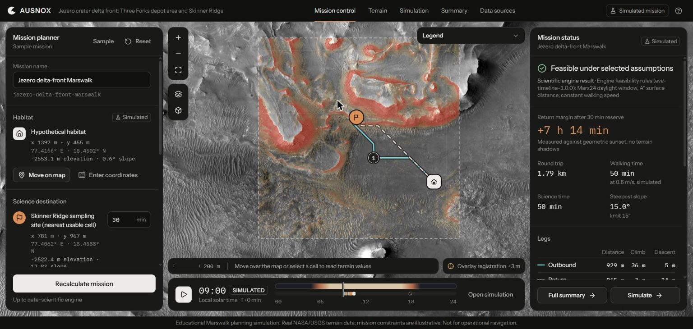

# AUSNOX

**Navigating the Red Planet from Dawn to Dusk.**

**Live application: [ausnox.vercel.app](https://ausnox.vercel.app).** Ausnox runs on `@ausnox/scientific-engine` and the validated Jezero terrain asset: USGS HiRISE DTM (MRO) for elevation, slope and A* routing; NASA Mars Trek imagery (MRO HiRISE and CTX, MGS MOLA); cited Perseverance (Mars 2020) rover positions as science targets; Mars24 daylight; engine feasibility rules. The optional 3D viewer uses the same measured terrain. Current release checks, keyboard verification, deployment evidence and the demonstration are recorded in [docs/RELEASE_REPORT.md](docs/RELEASE_REPORT.md).

**[Watch the extended captioned walkthrough (90.360 seconds)](https://ausnox.vercel.app/demo/ausnox-mvp.mp4)** — compare routes, review the round trip, then increase science time to make an afternoon mission infeasible. [Download captions](public/demo/ausnox-mvp.srt). This walkthrough exceeds the 2026 submission's 30-second limit. **Submission demonstration:** the 25-second SI-watermarked showcase film linked on the Space Apps project page; see [production disclosure](film/production-disclosure.md).

Ausnox is a science-grounded Marswalk mission-planning prototype for **NASA Space Apps Challenge 2026 — Interplanetary Survival Guide: Martian Map**. Its primary persona is a hypothetical mission-control planner. The app combines real NASA/USGS Martian imagery and elevation with transparent, simulated EVA assumptions to compare round-trip science routes and daylight/mission time margins. **This is an educational research prototype, not flight-qualified navigation or astronaut safety guidance.** X2b remains failed and unresolved; imagery overlays may appear shifted by about 3 m. Formal screen-reader and full contrast audits remain separate from the recorded keyboard and tablet checks.

Official challenge: https://www.spaceappschallenge.org/2026/challenges/interplanetary-survival-guide-martian-map/

## The committed MVP

- **Jezero-only routing** inside a verified high-resolution DEM footprint; broader Mars exploration may be view-only.
- **Real geospatial data**: NASA mission imagery plus DEM-derived elevation and slope; missing cells must remain unknown, never flattened or invented.
- **Layered 2D map** with multiple NASA mission sources, dataset provenance, scientific targets, and clear coverage.
- User-placed habitat and science destination within valid cells, optional stop(s), and explicit outward **and return** path.
- **A*** with shortest-distance and lower-slope modes; infeasible and unknown routes are not called safe.
- Astronomically modeled daylight with a simulated, pausable mission clock; visible remaining return margin and the assumptions behind it.
- Responsive desktop-first dashboard, tablet usable, no login or required database; static-first deployment with offline-ready local processed route data.

**Integrated 3D terrain explorer:** Three.js renders the existing Jezero DEM inside Mission Control, with relief, elevation and slope styles, shared routes and simulation, terrain inspection, camera controls and a 2D fallback. Default height scale is 1×; imagery draping remains unimplemented and X2b remains unresolved. See [the 3D handoff and verification evidence](docs/3D_TERRAIN_HANDOFF.md).

## AI-Assisted Development & Transparency

OpenAI GPT models, OpenAI Codex and Anthropic Claude Code assisted planning, programming, interface design/refinement, scientific-engine and terrain-pipeline implementation/testing, 3D visualization, integration, documentation and verification automation. Repository handoffs and commit records support these categories; exact per-file/tool attribution is incomplete. [AI_USAGE.md](docs/AI_USAGE.md) distinguishes recorded contributions from owner-declared assistance and unknown details; [SI_DISCLOSURE.json](docs/SI_DISCLOSURE.json) provides code/workflow metadata.

Authentic NASA/USGS observations were not replaced with generated terrain. The shipped terrain grid, slopes, A* paths and daylight are **derived**; habitat/EVA assumptions and mission playback are **simulated**. Historical [scientific validation](docs/SCIENTIFIC_VALIDATION_REPORT.md) and [release evidence](docs/RELEASE_REPORT.md) record tests and reference comparisons, not NASA certification. X2b remains **FAIL**, with approximately 3 m potential imagery-registration discrepancy; geometric daylight, limited coverage and illustrative EVA assumptions prevent operational safety use.

The extended walkthrough is a real app recording with captions and no audio. A separately inspected short-film candidate uses real app captures, SI-assisted programmed compositing/score and ElevenLabs synthetic narration; sampled frames show an SI watermark and English captions, and metadata disclose the voice. Its public upload and rights checks remain pending. See [production disclosure](film/production-disclosure.md), [third-party notices](docs/THIRD_PARTY_NOTICES.md), [submission copy](docs/NASA_SUBMISSION_COPY.md) and [compliance status/blockers](docs/NASA_COMPLIANCE_REPORT.md).

## Documentation (`docs/`)

Specifications and compliance records live in [`docs/`](docs/); the root [LICENSE](LICENSE) applies to original project code, and `film/` holds media disclosure copy.

| Read first | Purpose |
| --- | --- |
| [docs/MASTERPLAN.md](docs/MASTERPLAN.md) | Scope, milestones, kill switches and priorities |
| [docs/PRD.md](docs/PRD.md) | Requirements, personas, stories and acceptance criteria |
| [docs/ARCHITECTURE.md](docs/ARCHITECTURE.md) | Static-first system design, schemas and boundaries |
| [docs/DATA_SOURCES.md](docs/DATA_SOURCES.md) | Candidate datasets, provenance, access and licensing checks |
| [docs/SCIENTIFIC_MODELS.md](docs/SCIENTIFIC_MODELS.md) | Mars coordinates, A*, slope, mission and solar models |
| [docs/UI_UX_SPEC.md](docs/UI_UX_SPEC.md) | UX behavior, states, accessibility and Figma handoff |
| [docs/IMPLEMENTATION_PLAN.md](docs/IMPLEMENTATION_PLAN.md) | Agent-ready dependency-ordered work packages |
| [docs/TESTING_AND_VALIDATION.md](docs/TESTING_AND_VALIDATION.md) | Scientific correctness, unit, integration and release gates |
| [docs/AGENT_GUIDELINES.md](docs/AGENT_GUIDELINES.md) | Non-negotiable rules for AI coding agents |
| [docs/FRONTEND_HANDOFF.md](docs/FRONTEND_HANDOFF.md) | What the frontend phase built, mock adapters, integration entry points, test evidence |
| [docs/SCIENTIFIC_ENGINE_HANDOFF.md](docs/SCIENTIFIC_ENGINE_HANDOFF.md) | Engine API, units, conventions and error contracts |
| [docs/DATA_PIPELINE.md](docs/DATA_PIPELINE.md) | How the Jezero terrain asset was produced from the USGS DTM |
| [docs/SCIENTIFIC_VALIDATION_REPORT.md](docs/SCIENTIFIC_VALIDATION_REPORT.md) | Scientific gates, evidence and the unresolved X2b finding |
| [docs/INTEGRATION_REPORT.md](docs/INTEGRATION_REPORT.md) | How frontend and engine were integrated, mappings, tests, verification |
| [docs/DEPLOYMENT_GUIDE.md](docs/DEPLOYMENT_GUIDE.md) | Install, build, static hosting and production checks |

## Quick start

Requires Node 20.19+ (verified on Node 24.13.0, npm 11.6.2, Windows 11). No API key, account or environment variable is needed.

~~~bash
npm ci              # also builds packages/scientific-engine (postinstall)
npm run dev         # real NASA/USGS data and the scientific engine
npm run dev:mock    # deterministic demonstration adapters (synthetic, labelled Illustrative)
npm run typecheck   # tsc -b --noEmit
npm run lint        # eslint (app and engine sources)
npx vitest run      # frontend, stores and actual Jezero geometry/adapter tests
npm run test:engine # engine package suite, 88 tests
npm run build       # static output in dist/ (real mode)
npm run test:browser # production 2D/3D workflow; install Playwright Chromium first
~~~

The install, check, test and build commands were run on 2026-11-15 and passed, and both dev servers were started and checked in Chrome; see docs/INTEGRATION_REPORT.md §10–12. Deployment steps: docs/DEPLOYMENT_GUIDE.md.

Repository layout: `src/` React app (services/contracts, real and mock adapters, stores, UI); `packages/scientific-engine/` TypeScript engine (coordinates, terrain, A*, Mars24, feasibility, simulation); `scientific-pipeline/` Python preprocessing and evidence; `public/data/jezero/` the shipped terrain asset. Stack: React + TypeScript + Vite + Leaflet + Tailwind + Radix + Zustand + Recharts; the route search runs in a Web Worker.

`VITE_DATA_MODE` selects the adapters: real (default, including production builds) or mock (only when set explicitly). The production bundle contains no mock code.

The older screenshots in `docs/screenshots/` (`mission-control.jpg`, `terrain.jpg`, `summary.jpg`) show the frontend phase on synthetic demonstration data.

## Development tooling: Agentation

[Agentation](https://www.agentation.com/) is a dev-only visual-feedback toolbar. You click a UI element, add a note, and the annotation (element name, selector, source file and line, bounding box, styles) is passed to Claude Code. It is not a product feature: `src/app/DevAgentation.tsx` renders it only when `import.meta.env.DEV` is true, via a dynamic import, so `npm run build` ships none of it. It needs no external service, account or API key.

1. `npm run dev`, open the app, and click the Agentation icon at the bottom right. Click an element, type a note and press Add. Click the X to close the toolbar.
2. Register the local MCP server with Claude Code once per machine, then restart Claude Code (or reload its MCP servers):
   ~~~bash
   claude mcp add agentation -- npx -y agentation-mcp server
   npx agentation-mcp doctor   # "Server not reachable" is normal until Claude Code has started the server
   ~~~
3. Check sync: add a note, then ask Claude Code to list pending Agentation annotations (`agentation_get_all_pending`). The same note and page should come back. Without the server the toolbar still works and keeps notes in the browser only.

The server listens on `http://localhost:4747` (by default it rejects non-local requests; the toolbar's `endpoint` in `DevAgentation.tsx` must match). Do not expose that port or set `AGENTATION_CORS_ORIGINS=*`.

## Primary development order

1. Read docs/AGENT_GUIDELINES.md, this README and all nine specification files in `docs/`.
2. Inspect the linked Figma draft if access allows; Fable may redesign while retaining task flows.
3. Confirm at least one NASA data source explicitly listed in the challenge's **Resources** tab; document evidence and credits.
4. **P0 data gate**: acquire a real Jezero DEM; validate CRS, geographic extent, nodata, units, slopes and overlap with imagery. No fake DEM substitution. *(Done: gates S1–S3, S5 pass; X2b fails, see the validation report.)*
5. Build functioning georeferenced 2D map, real-data routing, Mars-time and mission feasibility. *(Done on `integration/ausnox-mvp`.)*
6. Execute the full testing/release checklist, deploy and record the live demo. *(Public deployment verified; current checks and recording: docs/RELEASE_REPORT.md.)*
7. Only then attempt optional 3D or environmental layers.

## Important limits

The initial habitat is fictional; no live astronauts or shelters are tracked. Walking speeds, traversal thresholds and EVA reserves are illustrative user-adjustable assumptions, **not NASA operational values**. MEDA is a localized historic meteorology source and not an operational Jezero-wide forecast or astronaut ionizing-radiation sensor. THEMIS infrared mosaics are contextual historical observations, not real-time temperature or a sunset forecast.

## Links

- NASA Mars Trek WMTS: https://trek.nasa.gov/tiles/apidoc/trekAPI.html?body=mars
- USGS Mars 2020 TRN HiRISE DTM actually used (Fergason et al., 2020): https://doi.org/10.5066/P9REJ9JN
- NASA Mars24 calculation reference: https://www.giss.nasa.gov/tools/mars24/help/algorithm.html
- NASA Space Apps 2026 Global Offers (optional, not data requirements): https://www.spaceappschallenge.org/2026/global-offers/
- Figma MARS draft (reference only; may require access): https://www.figma.com/design/EejtJslZYEA3RTeYntsURR/MARS?node-id=0-1

## Attribution and eligibility

Before final submission, verify that **at least one NASA resource used by Ausnox is listed in the challenge's own Resources tab**, and cite **every** scientific dataset, image, dependency, third-party asset and AI tool in the project submission. Record versions, licenses and retrieval dates in docs/DATA_SOURCES.md. The Figma file could not be inspected at documentation time. During the frontend phase it was viewed read-only in a browser and used as a reference for a redesign; there is no design-to-code parity and none is claimed (docs/FRONTEND_HANDOFF.md §13).

Original project code is available under the [MIT License](LICENSE), explicitly authorized by the owner. External datasets, fonts, libraries, design material and narration retain their own terms. [Third-party notices](docs/THIRD_PARTY_NOTICES.md) record exact dependency licenses (including restricted terms), credits and unresolved rights questions. MIT does not establish complete competition or third-party licensing compliance.

Data credits: USGS HiRISE DTM mosaic for Mars 2020 TRN (Fergason et al. 2020, doi:10.5066/P9REJ9JN; NASA/JPL-Caltech/University of Arizona); NASA/JPL Mars Trek WMTS (MRO HiRISE and CTX mosaics, MGS MOLA colour hillshade); NASA/JPL-Caltech Perseverance rover localizations (MMGIS) and raw-image metadata; NASA GISS Mars24 algorithm (Allison & McEwen 2000). Mars Trek and the Perseverance raw-image gallery, both used here, are listed on the challenge Resources tab (gate S5, `scientific-pipeline/evidence/challenge_resources.json`).

Documentation drafted on 2026-11-14 from the project brief and user-approved decisions; statuses updated on 2026-11-15 from recorded evidence.
