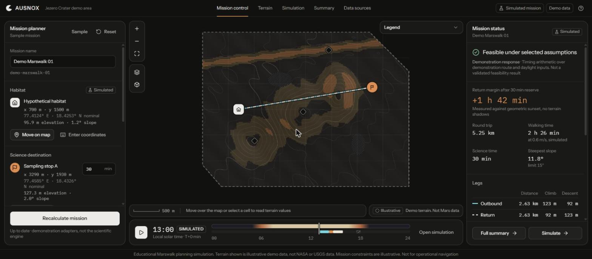

# AUSNOX

**Navigating the Red Planet from Dawn to Dusk.**

**Status (2026-11-14): frontend implemented on demonstration data; scientific engine not started.** The React app in this repository runs every P0 screen and interaction against clearly labelled mock adapters. No NASA/USGS dataset has been ingested, no ingest pipeline is verified, A* routing and the Mars24 solar model are not implemented, and nothing is deployed. Do not represent specifications or demonstration output as completed scientific work. See [docs/FRONTEND_HANDOFF.md](docs/FRONTEND_HANDOFF.md).

Ausnox is a proposed, science-grounded Marswalk mission-planning prototype for **NASA Space Apps Challenge 2026 — Interplanetary Survival Guide: Martian Map**. Its primary persona is a hypothetical mission-control planner. The app will combine real NASA/USGS Martian imagery and elevation with transparent, simulated EVA assumptions to compare round-trip science routes and daylight/mission time margins. **This is an educational research prototype, not flight-qualified navigation or astronaut safety guidance.**

Official challenge: https://www.spaceappschallenge.org/2026/challenges/interplanetary-survival-guide-martian-map/

## The committed MVP

- **Jezero-only routing** inside a verified high-resolution DEM footprint; broader Mars exploration may be view-only.
- **Real geospatial data**: NASA mission imagery plus DEM-derived elevation and slope; missing cells must remain unknown, never flattened or invented.
- **Layered 2D map** with multiple NASA mission sources, dataset provenance, scientific targets, and clear coverage.
- User-placed habitat and science destination within valid cells, optional stop(s), and explicit outward **and return** path.
- **A*** with shortest-distance and lower-slope modes; infeasible and unknown routes are not called safe.
- Astronomically modeled daylight with a simulated, pausable mission clock; visible remaining return margin and the assumptions behind it.
- Responsive desktop-first dashboard, tablet usable, no login or required database; static-first deployment with offline-ready local processed route data.

**3D**: desirable stretch feature, not a release gate. The published challenge overview requests a layered, integrated Martian map; it does not expressly demand a 3D globe. If time permits, add a georeferenced 3D view without sacrificing the validated 2D workflow.

## Documentation (`docs/`)

All specifications live in [`docs/`](docs/), which is the authoritative specification directory. Only this README stays in the repository root.

| Read first | Purpose |
| --- | --- |
| [docs/MASTERPLAN.md](docs/MASTERPLAN.md) | Scope, milestones, kill switches and priorities |
| [docs/PRD.md](docs/PRD.md) | Requirements, personas, stories and acceptance criteria |
| [docs/ARCHITECTURE.md](docs/ARCHITECTURE.md) | Static-first system design, schemas and boundaries |
| [docs/DATA_SOURCES.md](docs/DATA_SOURCES.md) | Candidate datasets, provenance, access and licensing checks |
| [docs/SCIENTIFIC_MODELS.md](docs/SCIENTIFIC_MODELS.md) | Mars coordinates, A*, slope, mission and solar models |
| [docs/UI_UX_SPEC.md](docs/UI_UX_SPEC.md) | UX behavior, states, accessibility and Figma handoff |
| [docs/IMPLEMENTATION_PLAN.md](docs/IMPLEMENTATION_PLAN.md) | Agent-ready dependency-ordered work packages |
| [docs/TESTING_AND_VALIDATION.md](docs/TESTING_AND_VALIDATION.md) | Scientific correctness, unit, integration and release gates |
| [docs/AGENT_GUIDELINES.md](docs/AGENT_GUIDELINES.md) | Non-negotiable rules for AI coding agents |
| [docs/FRONTEND_HANDOFF.md](docs/FRONTEND_HANDOFF.md) | What the frontend phase built, mock adapters, integration entry points, test evidence |

## Quick start (frontend, demonstration data)

Requires Node 20.19+ (verified on Node 24.13.0, npm 11.6.2, Windows 11).

~~~bash
npm install
npm run dev         # Vite dev server
npm run typecheck   # tsc -b --noEmit
npm run lint        # eslint
npm run test -- --run
npm run build       # static output in dist/
~~~

These commands were executed on 2026-11-14: typecheck, lint, 62 tests and the production build all passed. Results and what was not run are recorded in docs/FRONTEND_HANDOFF.md §14.

The app defaults to `VITE_DATA_MODE=mock`: a synthetic terrain surface, demonstration route arcs and fixed example daylight times, all labelled *Illustrative* in the interface. `VITE_DATA_MODE=real` selects the real-adapter extension points in `src/services/adapters/real/`, which are not implemented and answer "unavailable". Stack: React + TypeScript + Vite + Leaflet + Tailwind + Radix/shadcn-style components + Zustand + Recharts. The Python + Rasterio/NumPy preprocessing described in docs/ARCHITECTURE.md does not exist yet. Not deployed.

## Primary development order

1. Read docs/AGENT_GUIDELINES.md, this README and all nine specification files in `docs/`.
2. Inspect the linked Figma draft if access allows; Fable may redesign while retaining task flows.
3. Confirm at least one NASA data source explicitly listed in the challenge's **Resources** tab; document evidence and credits.
4. **P0 data gate**: acquire a real Jezero DEM; validate CRS, geographic extent, nodata, units, slopes and overlap with imagery. No fake DEM substitution.
5. Build functioning georeferenced 2D map, real-data routing, Mars-time and mission feasibility.
6. Execute the full testing/release checklist, deploy and record the live demo.
7. Only then attempt optional 3D or environmental layers.

## Important limits

The initial habitat is fictional; no live astronauts or shelters are tracked. Walking speeds, traversal thresholds and EVA reserves are illustrative user-adjustable assumptions, **not NASA operational values**. MEDA is a localized historic meteorology source and not an operational Jezero-wide forecast or astronaut ionizing-radiation sensor. THEMIS infrared mosaics are contextual historical observations, not real-time temperature or a sunset forecast.

## Links

- NASA Mars Trek WMTS: https://trek.nasa.gov/tiles/apidoc/trekAPI.html?body=mars
- USGS Jezero HiRISE DTM release: https://www.usgs.gov/data/mars-sample-return-hirise-mosaics-terrain-relative-navigation
- NASA Mars24 calculation reference: https://www.giss.nasa.gov/tools/mars24/help/algorithm.html
- NASA Space Apps 2026 Global Offers (optional, not data requirements): https://www.spaceappschallenge.org/2026/global-offers/
- Figma MARS draft (reference only; may require access): https://www.figma.com/design/EejtJslZYEA3RTeYntsURR/MARS?node-id=0-1

## Attribution and eligibility

Before final submission, verify that **at least one NASA resource used by Ausnox is listed in the challenge's own Resources tab**, and cite **every** scientific dataset, image, dependency, third-party asset and AI tool in the project submission. Record versions, licenses and retrieval dates in docs/DATA_SOURCES.md. The Figma file could not be inspected at documentation time. During the frontend phase it was viewed read-only in a browser and used as a reference for a redesign; there is no design-to-code parity and none is claimed (docs/FRONTEND_HANDOFF.md §13).

Documentation drafted on 2026-11-14 from the project brief and user-approved decisions; implementation statuses must be updated with evidence, not assumptions.
