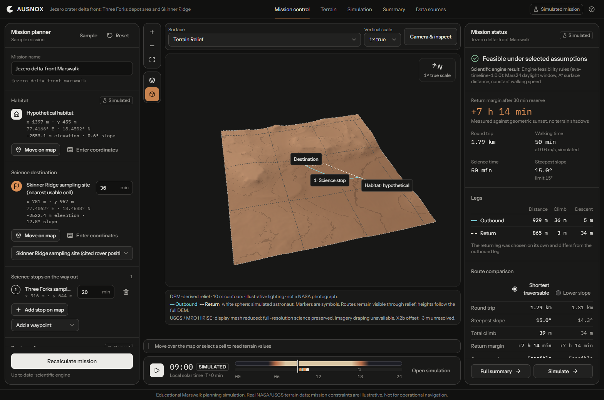
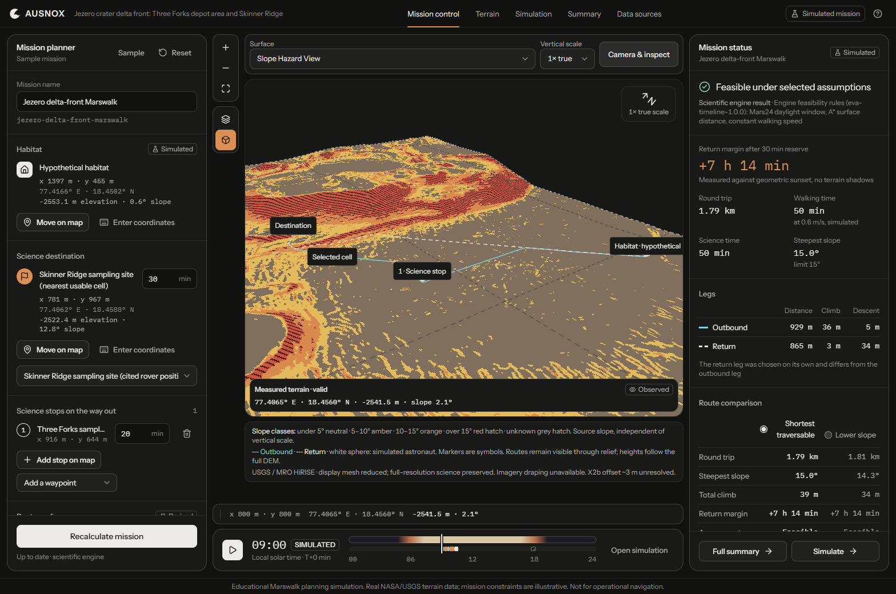

# Three.js Jezero terrain explorer

Branch: `feat/3d-jezero-explorer`, based on freshly fetched `origin/main` at `a9a256cf89fc09a120447c9fdffa3e819d538760`. No changes to the scientific engine, pipeline, terrain assets or historical validation records.

## Feature and dependencies

The existing Mission Control, Terrain and Simulation workspaces use the original **cube icon** beneath the layer control to toggle 3D. It lights up in copper while 3D is active; clicking it again returns to 2D. The button exposes its state through `aria-pressed` and supports Enter/Space. There is no separate 2D/3D selector. The views share one loaded DEM, mission configuration, pair of route-mode results, assessments and simulated clock. The feature does not introduce another route planner or clock.

Added exact versions: `three` **0.187.0**, `@types/three` **0.187.0**, `@playwright/test` **1.65.1** (development only). Existing React **19.3.1**, TypeScript **6.0.3**, Vite **8.3.8**, Zustand **5.1.0** and `@ausnox/scientific-engine` **0.1.0** remain in use. Three.js is MIT licensed; Playwright is Apache-2.0. AI-assisted implementation: OpenAI Codex.

No credentials or new environment variables are required. `VITE_DATA_MODE` retains its existing meaning. The 3D viewer refuses unverified and illustrative terrain rather than presenting synthetic terrain as Mars. Unit-test fixtures remain test-only.

## Architecture and ownership

| File | Responsibility |
| --- | --- |
| `src/components/map/TerrainView.tsx` | Lazy import, loading UI and React error boundary |
| `src/components/map/three/Mars3DViewer.tsx` | Accessible surface, exaggeration, camera and inspection controls; failure UI |
| `TerrainScene.ts` | WebGL renderer, official OrbitControls/CSS2DRenderer, state subscriptions, picking, routes, markers, camera, cleanup |
| `TerrainCoordinates.ts` | Tested local ground-metre frame, cell centres, full-resolution surface sampling and focus bounds |
| `TerrainMesh.ts` | Indexed, masked display geometry with bounded resolution |
| `TerrainMaterial.ts` | Full-resolution DEM/slope RGBA textures and surface-style boundary |

`uiStore.mapMode` is presentation state only. `mapStore.threeControls` exposes zoom to the existing tools. The Leaflet map stays mounted, hidden, during 3D use, preserving its resources and viewport; it invalidates its size on return. The Three scene is disposed when leaving 3D. Its lazy chunk is absent from the initial 2D load.

## Scientific dataset and provenance

Geometry comes exclusively from the existing `dataStore.raster` and `dataStore.manifest`, populated by the real terrain adapter and scientific engine loader. There is no second terrain request, original GeoTIFF download, generated topography or new acquisition pipeline.

- USGS HiRISE DTM mosaic for Mars 2020 Terrain Relative Navigation, MRO / HiRISE; Fergason et al. (2020), [DOI 10.5066/P9REJ9JN](https://doi.org/10.5066/P9REJ9JN).
- Product: `JEZ_hirise_soc_006_DTM_MOLAtopography_DeltaGeoid_1m_Eqc_latTs0_lon0_blend40.tif`; original observations and processing metadata remain in the manifest and `DATA_PIPELINE.md`.
- Shipped derivative: **800 × 800** cells, **2 m projected** spacing, **5,760,000 bytes**, SHA-256 `fcb96e32bc854fff23d56ee4301bea7a77a38e892afc24ada6d0ce5aea1b7f49`.
- Source heights are relative to the Mars areoid, USGS MOLA topography / DeltaGeoid convention.
- The adapter verifies manifest, CRS, checksum and raster integrity before making the dataset available.

The implementation reads dimensions, ranges, footprint and physical extents at runtime. The numbers above describe the committed asset, not hardcoded geometry parameters.

## Coordinates, orientation and scale

The existing adapter owns geographic ↔ projected-grid conversion. Geographic coordinates are planetocentric latitude and east-positive longitude on the Mars 2000 sphere, radius **3,396,190 m**. Absolute projected coordinates are converted to AOI-relative metres by subtracting the southwest projected bound. The engine raster is north-up; the existing frontend adapter reverses rows once, so frontend **row 0 is south**.

A vertex at frontend cell `(col,row)` uses the cell centre:

```text
grid.x = (col + 0.5) × projectedWidth / columns
grid.y = (row + 0.5) × projectedHeight / rows

world.X = (grid.x − projectedWidth / 2) × groundWidth / projectedWidth
world.Y = (measuredElevation − minimumMeasuredElevation) × visualVerticalScale
world.Z = −(grid.y − projectedHeight / 2) × groundHeight / projectedHeight
```

This is a documented local tangent-plane approximation using the engine-derived centre-latitude ground extent. A source cell is approximately **1.897 m east–west × 2 m north–south**, rather than a physically square 2 m cell. Across this small AOI the centre approximation differs from geodesic east–west cell spacing by less than **0.01%** (tested at south, centre and north). It is unsuitable for extending the viewer to a large region without revisiting the projection.

World X is east, Y is elevation, Z is south. Picking, markers, routes and focus use the same reversible frame. Geographic inspection delegates back to the terrain service. Reported elevations remain the original negative areoid values; subtracting the common minimum is only a scene reference offset.

Default vertical scale is **1×**. Optional **2× / 3×** values rebuild display heights and reposition overlays; they never modify raster arrays, reported elevations, source slopes, route searches, distances, feasibility or time. A newly opened scene starts at 1×. Lighting is illustrative cartographic lighting, not a simulated Sun or terrain-shadow prediction.

## Display mesh, missing data and materials

The mesh retains authentic source samples at a bounded stride: at most **201 samples per side** in normal use (**40,401 vertices / 80,000 triangles** for the committed asset), versus 640,000 scientific cells. Each retained vertex reads its source elevation directly. Routing continues on the unchanged full-resolution dataset.

A summed-area mask checks **every source cell inside each simplified quad**, including cells skipped by decimation. If any elevation is unsupported or non-finite, both triangles are omitted. Invalid vertex storage is never indexed or picked; no missing cell becomes a zero-height surface. This conservative mask can make holes larger than individual missing cells. An entirely unsupported mesh fails explicitly. The current committed DEM contains no missing elevation cells; a deterministic fixture tests gaps between retained vertices.

Textures retain all **800 × 800** source samples, use cell-centre UVs, nearest filtering and no mipmaps. South-up texture rows match the mesh. Unknown slope stays grey hatched, including the actual outer ring; it is never classified as gentle or accepted for placement.

| Style | Meaning |
| --- | --- |
| Terrain Relief | Restrained derived colour, measured geometry, 10 m contours, ambient/directional lighting; explicitly not a photograph |
| Elevation View | Existing elevation ramp; exact dataset endpoints and areoid metres in the legend |
| Slope Hazard View | Reuses the 2D `SLOPE_CLASSES`: `<5°`, `5–<10°`, `10–<15°`, `≥15°`; matching amber/orange/red and steep hatching; unknown grey hatch |

**Imagery draping is not implemented.** NASA imagery remains available in 2D subject to provider access. No photograph is substituted. X2b remains **FAIL / unresolved**: apparent DTM-to-imagery displacement about **2.3–3.2 m east**. No geometry or UV shifts hide that finding. The 3D legend discloses it, and existing 2D provenance remains intact.

## Mission, route and simulation synchronization

The Three scene subscribes directly to existing Zustand stores. Mission changes update overlays, not the terrain mesh. Simulation ticks update only the astronaut object and schedule a frame; they do not reconstruct the scene or trigger per-frame React state updates. Unrelated panel state is ignored.

- Habitat, destination, ordered stops and cited targets use their actual shared coordinates and full-resolution measured surface heights. Symbolic markers have small readability offsets. Coincident cited-target labels are suppressed when the mission label already identifies that target; the actual source point remains rendered and is accessible in the existing science list.
- Outbound and independently searched return paths come from the selected engine result. Optional comparison uses the other existing mode result. Outbound is cyan solid; return is bone dashed; stale and comparison routes are faint.
- Polyline segments sample the original terrain at no more than half a projected source cell. Missing elevation or invalid coordinates reject the affected overlay with an explicit error. No smoothed or convenient substitute route is generated.
- Routes have a **0.7–1 m visual offset**. Depth occlusion is disabled for route visibility against the reduced display mesh. Thus a route may remain visible through intervening relief; its actual coordinates/heights still follow the full DEM. This is disclosed in the legend. The reduced surface can depart locally from fine route samples; close views must use source readouts for measurements.
- The astronaut uses the existing `snapshotAt` with `simStore.simS`, the selected route and assessment. It stops while paused, returns home on reset and disappears whenever results become stale, incomplete or reset. There is no Three-only clock. The existing simulation interpolation limitation (about one cell compared with the engine timeline) is unchanged.

Changing visualization modes does not call `calculate`, edit a mission, change route preference, invalidate results or reset progress. Surface choices update existing `slope` / `elevation` visibility, so equivalent layers persist in 2D. If both 2D overlays are enabled, slope takes precedence in 3D.

## Camera, picking and accessibility

Official [OrbitControls](https://threejs.org/docs/pages/OrbitControls.html) provide orbit, pan and zoom. Wheel/pinch and the existing zoom buttons work in 3D. The camera menu provides reset, focus habitat, focus destination, fit route, orbit left/right and tilt up/down buttons. The shared Fit terrain action also resets framing. Bounds account for aspect ratio and the complete focused geometry. Distance, polar-angle and target bounds keep navigation useful. North rotates with camera azimuth; the axis convention is described accessibly.

Canvas keyboard: arrows pan, `+` / `−` zoom, `R` fits terrain. Camera buttons provide touch/keyboard alternatives to dragging. Reduced motion disables damping; there are no animated camera flights. ResizeObserver resizes camera, WebGL and labels; device pixel ratio is capped at **1.5**.

Raycasting finds display X/Z, then the terrain service supplies the authentic full-resolution elevation, slope, geographic coordinate and validity. A missed surface can be inspected on the reference plane to expose outside/unsupported coverage, rather than inventing elevation. Orbit drags and multi-touch gestures do not place points. Selected-cell and proposed-snap labels are passive; proposed snaps still require the existing explicit confirmation.

The camera menu also offers keyboard coordinate inspection. Habitat/destination placement retains the existing grid/geographic coordinate dialog. Both raycast and marker selection call `uiStore.attemptPlace`; slope limits, missing data and confirm-to-snap policy stay in the existing workflow. Science selection, assumptions, route comparison, reset and simulation panels remain available, including tablet sheets. Inspection shows measured elevation, derived slope, validity, coordinates and a source drawer action.

## Resilience and resource lifecycle

[WebGLRenderer](https://threejs.org/docs/pages/WebGLRenderer.html) requires WebGL2. Missing WebGL, renderer initialization failure, missing/unverified terrain and React/lazy-load errors produce a contained fallback with **Return to 2D Map**. Context loss stops the render loop and presents the same return action. Returning to 3D retries with a fresh context. No renderer failure resets or replaces mission state.

On teardown, unsubscribe stores; disconnect ResizeObserver and reduced-motion listeners; remove keyboard/pointer/context handlers and label DOM; cancel animation frames; dispose geometries, route/marker materials, terrain texture/material and renderer; release the WebGL context. Style changes dispose the old texture/material; scale changes dispose old geometry. No remote image texture exists to fail independently. Scene initialization is guarded and partial resources are cleaned on exceptions.

Rendering is demand-driven, with frames only for camera damping, resizing or changed visual state. Pixel work and mesh complexity are bounded; shadows and postprocessing are omitted. The lazy viewer chunk is approximately **586 kB / 148 kB gzip**. Vite reports its standard >500 kB chunk warning; it does not affect the initial 2D bundle.

## Verification and performance evidence

Executed on **2026-11-15**, Windows / Node **24.13.0**. Initial implementation: `7cd877f`; the cube-toggle revision was rechecked with typecheck, lint, all 97 frontend/integration tests, production build and all three browser scenarios. The scientific engine and dependencies did not change in that UI revision. Results:

| Check | Result |
| --- | --- |
| `npm ci` | **PASS**, 382 packages; engine built in postinstall. The original optional WASM lockfile entries are preserved |
| `npm run typecheck` | **PASS**, no errors |
| `npm run lint` | **PASS**, no errors or warnings |
| `npx vitest run` | **PASS**, 7 files / **97 tests** (original 86 plus 8 geometry/integration and 3 React/store tests) |
| `npm run test:engine` | **PASS**, 6 files / **88 tests** |
| `npm run build` | **PASS**, Vite production build 1.96 s; lazy 3D chunk 586.23 kB / 147.75 kB gzip, advisory chunk-size warning |
| Production Playwright | **PASS**, **3 tests**, 48.8 s; 1568×1040 desktop, 820×1180 tablet and live resize to 1024×820 |
| Original dataset checksum | **PASS**, SHA-256 unchanged |
| Scientific-engine / pipeline / public terrain diff | **PASS**, no changes |
| New Python pipeline run | **NOT RUN**, no processing code or data changed |

Geometry tests use the committed binary and real adapter, plus one explicitly test-only no-data fixture. They cover east/north orientation, physical spacing against Mars geodesics, geographic/grid/world round trips, source cell-centre heights and normals, real A* route/marker alignment, finite focus bounds, visual-only scale, unknown slope, no-data patches skipped by decimation, corrupt dimensions and unsupported inputs. React/store tests verify result-object identity and paused clock preservation, coordinate rejection/explicit snap, renderer containment and unmount disposal. GPU rendering is tested by Playwright, not simulated by the React tests.

The production browser suite exercised all three materials, both route legs, point/route camera focus, orbit/tilt, typed and raycast inspection, playback/pause, mode preference, visual scale/reset, repeated 2D/3D remounts, route comparison, rejected typed placement, mission reset/sample reload and context loss. The actual terrain binary was requested **once** across repeated mode switches. It also forced WebGL unavailable and returned to the working Leaflet map. Context-loss cleanup removes marker labels and the renderer. No application console errors or failed local requests occurred; the three blocked NASA probe URLs are recorded separately.

Measured in the production build with **headless Chromium 158**, **Intel Iris Plus / ANGLE Direct3D11**, DPR **1**:

| Measurement | Observed |
| --- | --- |
| First scene assembly, including geometry, texture and overlays | **223.30 ms** |
| Mean renderer + label CPU time across 68 rendered frames | **3.28 ms** |
| Orbit sample, 64 animation-frame intervals | Mean **19.01 ms** (~53 fps), p95 **16.80 ms**; one long interval affects the mean |
| Idle frame scheduling | **No extra frames** during the 200 ms idle assertion |
| Display complexity | **40,401 vertices / 80,000 triangles** |

These are short measurements on one integrated GPU, not a broad device certification. The renderer CPU timing includes early shader work; a newly remounted scene's two-frame mean (18.05 ms in the record) is cold-start dominated and is not steady-state frame rate. The repeat scene assembly measured 81.50 ms. Exact test outcomes, hardware, timings, route counts and blocked requests are committed in [`screenshots/3d/verification.json`](screenshots/3d/verification.json).

The toolbar revision restores the original cube icon under Layers, removes the separate view selector and uses a flat copper active fill. Mouse click, Enter and Space toggle the same shared view state; `aria-pressed` follows both directions and renderer fallback. The existing state-preservation test now exercises the actual toolbar toggle, and Playwright confirms that the old selector is absent. Production screenshots were refreshed. Additional review at 1440, 768 and 390 px confirmed the active/inactive control and 44 px touch targets; the existing dense phone map/marker layout is outside this component change. Design-taste source lint returned **0 FAIL / 0 WARN** for the changed UI files. Its standalone browser inspector timed out at `Page.enable` on both installed Chromium variants, so visual review used the working Playwright browser and screenshots instead; no inspector pass is claimed.

Screenshots are real production-browser captures in `screenshots/3d/`:

1. `01-2d-mission-control.png`
2. `02-3d-overview.png`
3. `03-3d-elevation.png`
4. `04-3d-slope.png`
5. `05-3d-routes.png`
6. `06-3d-simulation.png`
7. `07-tablet-3d.png`
8. `08-webgl-fallback.png`

The browser environment blocks NASA Mars Trek network requests; captures use the existing **real DTM-derived 2D relief fallback**. No live imagery success is claimed in this feature verification.





## Reproduction

```bash
npm ci
npm run typecheck
npm run lint
npx vitest run
npm run test:engine
npm run build
npx playwright install chromium
npm run test:browser
```

The browser suite serves the existing production `dist/` using Vite preview at `127.0.0.1:4173`, or reuses an already running preview there. `PLAYWRIGHT_CHROMIUM_EXECUTABLE` optionally selects an installed Chromium for test tooling only. On Windows, stop Vite before `npm ci` so native CSS/compiler binaries are not locked. No Python data-processing code was touched, so no new pipeline validation is necessary; prior scientific evidence is preserved.

## Limitations and next layers

- One small AOI, static display LOD at approximately 8 m; no local mesh refinement. Numerical inspection and routing retain the 2 m source grid.
- No imagery draping, imagery registration correction, environmental products, forecasts, terrain shadows or real astronaut model.
- Rocks, steps, footing, loose material and fine obstacles cannot be inferred from this DEM. Mission assumptions remain illustrative; this is educational research software, not operational navigation.
- Real physical tablet/touch hardware, screen-reader review and broader GPU/browser benchmarking remain separate validation work. Browser emulation does not certify every ordinary laptop or tablet.
- Future environmental integration should add a separately validated data contract/store entry and a material overlay renderer at `TerrainMaterial.ts`, together with its own legend, timestamps, coverage, missing-data policy, provenance and uncertainty. Keep layer visibility in shared UI state. Reuse `TerrainCoordinates` and the existing frame invalidation/disposal lifecycle. Never alter the base DEM, source slopes or engine routes to paint an overlay. **No dust, temperature, pressure, radiation or placeholder environmental data is implemented in this branch.**
